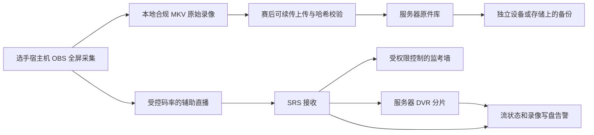

# 录屏系统优化计划与容量测试

> 状态更新：本文主体保留首次核查和容量短测时的快照。随后整改已实际部署，当前配置、验证结果及未完成的现场验收见 `service/README.md` 和 `deployment-and-acceptance.md`；下文“尚未部署 / 未运行”等表述仅对应首次核查时点。

日期：2026-10-19，Asia/Shanghai。目标服务器：`ncoai@202.112.51.208`。

## 1. 结论与边界

**现有 `/data` 的容量和短时写入性能能支持数百路录像；目前优先处理客户端合规、监考服务和归档可靠性，网络扩容要按实际赛场链路决定。**

- 网口 `eno5` 协商为 1000 Mbps、全双工。它不是已承诺的千兆公网带宽。
- `/data` 当前可用 **24.43 TiB，约 26.86 TB**，`df` 使用率约 77.82%。
- 直接顺序写短测约 **1561 MB/s**；500 路、每路 2 Mbps 的文件写入模拟达到 **126.5 MB/s**，无 fio 错误。
- Cloudflare 到服务器的四连接下载为 **611–637 Mbps**。服务器向该节点上传波动明显，约 **18–196 Mbps**；不能以最快一组承诺公网出口。
- 本机 Mac 到服务器的原生 TCP 为 **148–156 Mbps**，服务器到 Mac 为 **129–208 Mbps**。这只代表当前两点间的路径。
- 因此，**不能直接承诺 200 人各 2 Mbps 跨公网直播，更不能承诺 500 人各 2 Mbps**。200 人的存储需求没有问题，直播需要调整辅助推流码率并在实际赛场验收。
- 本轮完成的是计划和基础资源测试；没有部署整改，没有进行 SRS 业务并发验收，也没有跑 7 小时全程演练。

选手人数、观看并发和保留期限尚未提供。本计划按 **100 / 200 / 500 人、两天、每天 7 小时**测算，直播与录屏总码率分别以 0.5 / 1 / 2 Mbps 建模。码率含音频。保留期暂按“一届赛事完整保留，赛后 30 天复核是否清理”规划，具体期限应由组织方确定。

## 2. 目标架构

本地原始录像负责满足 PDF 的录屏要求，辅助直播负责现场监考。网络中断时，本地录制必须继续。直播副本的参数可以单独规划，不能用修改本地强制录制参数来节省直播流量。

同一 RAID 上的 DVR 和上传原件只是两套文件，**不是两份独立容灾备份**。

## 3. 完整实施计划

### P0-A：统一选手端 OBS，先保证有效原件

1. 在选手宿主机安装 OBS；若做题环境是 VM，也要录宿主机完整屏幕。
2. 场景只保留一个显示器采集视频源，检查源可见性、所有裁切值、滤镜、覆盖图层和场景切换。移除测试场景中的其他视频源。
3. Base Canvas 匹配实际屏幕；输出保持相同宽高比，16:9 可用 1280×720，16:10 建议 1280×800。不得通过裁边凑分辨率。
4. 本地录制按附录设置：Advanced、1 FPS、MKV、x264、CRF 24、High、FFmpeg AAC、44.1 kHz、Mono。
5. 本地文件按选手、日期、场次命名，放到确定可写且空间足够的目录；每台机器的容量至少覆盖预估两天原件和 25% 余量。不得只保存到临时目录。
6. 每台设备录制 10–15 分钟，覆盖终端小字、浏览器、VM、全屏应用和屏幕四边。人工检查成片可读性并导出 profile、场景 JSON 作为配置凭据。
7. 正式开赛前提前 5–10 分钟开始，确认正在录制、计时和文件增长；比赛结束后再停止。关闭自动休眠并核实供电。

验收：每台设备配置检查通过、短片可完整解码、画面无裁切，且断网时本地录制继续。CRF 24 是质量控制，**不是固定 Mbps**；应采集多种操作下的平均和峰值码率，更新容量模型。

### P0-B：恢复并固定服务器部署

1. 先备份 `/data/2027nco` 配置，固定 SRS 镜像版本和 digest，验证配置后启动服务；检查自动启动和异常退出后的恢复。
2. 修复 DVR 日期、文件名占位符，以“赛事 / 场次 / 选手 / 流会话 / 分片”组织目录。实际试录并检查生成路径，不只检查配置文字。
3. 保留按时间分片的辅助 DVR，保存每次推流开始、断开、重连和分片起止时间。等待关键帧导致的分片时长浮动不等于丢帧，不能要求每片恰好 1800 秒。
4. 按发布连接数、播放连接数和管理连接数计算 `max_connections`；当前 500 不能直接覆盖 500 人加监考观看。500 人方案可先以 2048 为配置候选，并核对文件描述符限制，再做业务压测。
5. 日志设轮转；加健康检查，验证 API、推流、播放、DVR 文件创建和持续增长。单独能打开首页不算验收通过。
6. 对管理 API、推流身份、监考观看和原件下载分别授权，禁止选手冒用其他选手流名；网页与传输使用适合赛场网络的 TLS 或受控专网。管理 API 不直接开放给所有选手。

验收：使用正式客户端连续试录，重启服务和重连后不覆盖旧文件，日志可以定位每位选手每次会话。服务器 DVR 的 MP4 仅作辅助副本，不通过改后缀伪装成本地 MKV 原件。

### P0-C：修复归档与原件提交

1. 统一实际流名与目录规则，移除脚本对 `*-hi` 的硬编码，覆盖现有 `NCO2027-001` 形式。
2. 固定一个真实包含 `ffmpeg` 和 `ffprobe` 的工具环境，检查可执行文件和版本；不再依赖当前 SRS 镜像里不存在的 `ffprobe` 路径。
3. 让 concat 清单位于容器可访问的挂载目录，修复路径映射。优先保存原片及清单，合并文件仅作为派生物。
4. 对上传原件做断点续传、上传中临时文件和完成后的原子改名，校验客户端与服务端 SHA-256 一致。收到完成确认后，才标记该选手已提交。
5. 清单至少记录选手、场次、UTC 起止、原始路径、文件大小、时长、视频/音频参数、哈希、解码结果、异常和通报记录。比赛日历另标场地时区，避免把北京时间与 PDF 的 UTC+1 混淆。
6. 校验完整解码、文件参数、所有片段的顺序和比赛时间覆盖；结合采集日志判断断档。不能把“各片时长相加达到 7 小时”当作无缺口证明，也不能用直播心跳代替本地录制状态。
7. 保留损坏原件和异常记录，禁止自动删除或重新编码覆盖。转封装不能修复原来漏录的画面，也不能让 CBR 原片变成原始 CRF 24 录像。

验收：用正常文件、缺片、重名、损坏文件、带空格路径、断点上传和重复提交样本验证清单与错误处理；提交清单必须与实际名单一致。

### P1-A：优化监考墙和异常响应

1. 明确区分“未连接、推流在线、画面停滞、播放失败、DVR 未增长、磁盘异常、已提交”，API 失败时显示未知或不可用状态。
2. 播放自动重连并有退避，页面销毁时释放播放器；不要吞掉错误。将 flv.js 静态资源放在受控位置，避免赛场无法访问外部 CDN。
3. 默认只播放当前分页可见的 16–25 路，翻页销毁旧连接；点击选手放大已有源，避免不必要的重复播放连接。刷新后恢复选手分组。
4. 以 3–5 秒周期检查流状态和录像写盘，以 15–30 秒无画面或无预期写入作为告警候选阈值；1 FPS 源需考虑关键帧和缓冲，演练后确定最终阈值。
5. 建立告警确认、志愿者立即通报、恢复确认和异常留痕流程。自动重启和重连不能替代 PDF 要求的现场报告。
6. 接入已有监控，展示网口双向速率、每路码率、活跃连接、TCP 重传、磁盘可用量与增长预测、I/O 延迟、服务重启和录像增长状态。

验收：主动制造断流、API 不可用、只停 DVR 写入和播放器失败，监考端均能识别，告警有人确认。监考日志不能单凭流名推定真实选手身份。

### P1-B：网络策略与扩容条件

1. 本地录制维持规则参数。辅助直播先以 **0.5–1 Mbps 总码率**作为候选，画面是否可读由验收决定；按观测到的峰值而非仅平均值预留带宽。不要假定 CRF 24 可以被严格限制在该码率。
2. OBS 本地录制和直播使用分别配置的编码输出，保持符合规则的本地 1 FPS。若要更高帧率直播，需单独评估客户端能力和实现，不为直播修改本地录屏要求。
3. 临时将服务器入站业务预算设为 **400 Mbps**，这是基于本次短测保留余量后的规划值，不是运营商保证。当前 Mac 这条路径的入站规划预算最多先按 **100 Mbps**。
4. 每个赛场分别测到服务器的入站、服务器到该场地的回放，以及链路繁忙时的表现。多场地的吞吐不能照搬一个 Mac 的测试值，赛场共用出口也不能按每台电脑独立带宽相乘。
5. 按监考端实际播放连接数计算出口：例如 4 位监考员各播放 25 路，共 100 个播放连接；每路 1 Mbps 时按 30% 余量计，需要约 130 Mbps 出口。
6. 赛后上传与比赛直播分时，限制上传并发和总速率；查询、下载与原件校验也要避免抢占比赛时的资源。
7. 若单场地回程不足，优先使用组织方管理的场内接收与归档点，再异步回传；若需求持续超过千兆单方向能力，升级 10GbE、交换机链路和公网接入，或分接收节点。只换网卡不能改善受限的公网路径。

千兆全双工的入站和出站分别核算，不机械相加后与 1000 Mbps 比较；但共享公网策略、交换机和赛场出口可能施加其他限制。

### P1-C：空间、备份与保留策略

1. 给本届赛事先安排 **6 TiB，约 6.60 TB** 的逻辑空间预算，包含原件、DVR 和派生物。该预算只是建议，尚未设置配额。
2. 当前用户可用空间为 26.86 TB，但 `/data` 被其他业务共享，不能全部承诺给录像。按 `df` 使用率最多 85% 计算，还可新增约 **8.70 TB，约 7.91 TiB**。这里使用 `used/(used+available)`，不占用文件系统保留块。
3. 200 人、每路 2 Mbps、两天、同码率两套文件再加 25% 余量，约需 **6.30 TB**，可放入上述 6 TiB 预算。500 人同条件为 **15.75 TB**，会超过维持 85% 使用率的空间余量。
4. 若本地原件为 2 Mbps、辅助直播为 0.5 Mbps，200 人两天的原件加 DVR 再留 25% 余量约为 **3.94 TB**。两类码率应分别测量，不能总是按相同值计算。
5. 设置空间趋势和阈值告警：80% 预警、85% 加急处理、90% 紧急处理；优先迁移已验证的副本、限制新上传和派生处理，不能自动删除未确认原件或直接停止正在进行的本地录制。
6. 原件完成后复制到独立存储并校验哈希，定期抽样恢复。保留期内不自动删原件；清理须按赛事和清单执行，并保留审核记录。
7. 检查 RAID 级别、物理盘健康、重建状态、控制器缓存与断电保护、UPS；本次普通账号检查未验证这些项目。RAID 不代替备份。

保留 30 天不等于要多乘 30 倍：一届只录两天的比赛，保留期内数据量大致固定；若每天都有新比赛或新录屏，才按新增录制天数累计。

### P2：验收、上线和回退

| 阶段 | 内容 | 通过条件 |
| --- | --- | --- |
| 第 1 阶段，约 1 个工作日 | 修客户端配置、服务部署、归档工具和目录 | 每台短片合规，服务和归档可正常运行 |
| 第 2 阶段，约 1 个工作日 | 监考状态、告警、权限、原件上传和清单 | 异常不漏报，原件哈希与名单可核对 |
| 第 3 阶段，约半天 | 真实赛场到服务器的带宽和 1.3 倍目标负载短测 | 直播无持续积压，DVR 无写入错误，观看稳定 |
| 第 4 阶段，至少 7 小时加复核时间 | 全时长演练，覆盖真实人数和观看并发 | 所有本地原件覆盖整场，可完整解码，异常已通报留痕 |
| 上线前 | 冻结版本、名单、profile、场景、容量和操作手册 | 指定值班责任人，现场检查通过 |

全程演练需包含：短时断网、直播重连、接收服务重启、单路推流失败、播放器失败、原件上传中断、校验失败和告警送达。磁盘空间不足只在独立配额或测试环境模拟，不填满共享 `/data`。

演练后由组织方确认实际录屏连续性和提交规则。出现服务回退时恢复上一版本服务器配置，保留全部 DVR 和上传原件；本地 OBS 原始录制始终独立继续。

## 4. 本次实测方法与结果

没有安装系统软件或变更防火墙。`fio` 和 Linux `iperf3` 仅将 Ubuntu 软件包解到独立临时目录；Mac 的 iperf3 从 ESnet 3.17.1 源码编译到临时目录，没有全局安装。

存储仅操作新建的 `/data/2027nco/.capacity-test-20261019.kzaCp4`，文件占用峰值约 16 GiB，实际写入约 16.4 GB。测试结束已删除该目录。没有读写块设备，没有清理系统缓存，没有改动已有录像。网络测试仅传送合成字节。

### 存储测试

`fio 3.36` 使用 `direct=1` 绕过 Linux 页缓存；写测试设置 `end_fsync=1`。RAID 控制器缓存仍可能影响结果，不将短测速率当成 7 小时持续性能或断电持久性证明。

| 工作负载 | 数据量 / 时间 | 聚合吞吐 | I/O 完成延迟 P99 | 结果 |
| --- | --- | --- | --- | --- |
| 单文件顺序写，1 MiB，QD16 | 8 GiB，约 5.5 秒 | 1560.7 MB/s | 166.7 ms | 无错误 |
| 同文件直接顺序读，1 MiB，QD16 | 8 GiB，约 4.5 秒 | 1889.1 MB/s | 30.5 ms | 无错误 |
| 32 文件并发写，256 KiB | 总计 4 GiB，约 2.3 秒 | 1895.4 MB/s | 37.5 ms | 无错误 |
| 200 个文件，每路目标 2 Mbps | 20 秒，64 KiB 写入 | 50.94 MB/s | 11.6 ms | 无错误 |
| 500 个文件，每路目标 2 Mbps | 20 秒，64 KiB 写入 | 126.47 MB/s | 14.6 ms | 无错误 |

这两组多路模拟是 fio 文件写入，不是 200/500 个真实 OBS 推流，也没有包含 SRS 连接处理、视频解码和前端播放成本。限速测试起始块和结束边界会令实测速率略高于目标聚合速率。

### 网络测试

以下方向均以服务器为基准，Mbps 为十进制。HTTP 测速仅计成功 HTTP 200 请求；首次超大请求收到 403，未用于带宽结论，原始结果单独保留。HTTP 聚合速度包含 SSH 启动请求的时间，因此偏保守。

| 路径与方法 | 入站：发送到服务器 | 出站：服务器发送 |
| --- | --- | --- |
| Cloudflare 四连接，首轮 | 611.4 Mbps | 65.1 Mbps |
| Cloudflare 四连接，复测 | 637.2 Mbps | 82.9 Mbps |
| Cloudflare 单连接有效测试 | 411.5 Mbps | 两次分别 196.1、18.0 Mbps |
| Mac SSH 单连接，64 MiB | 125.3 Mbps | 231.8 Mbps |
| Mac SSH 四连接，共 256 MiB | 148.5 Mbps | 202.6 Mbps |
| Mac 原生 TCP，10 秒，单连接 | 152.9 Mbps | 129.0 Mbps |
| Mac 原生 TCP，10 秒，四连接 | 148.3 Mbps，另一次 156.3 Mbps | 208.5 Mbps |

原生 TCP 测试使用临时 52061 端口和一次性服务，服务有 25–30 秒超时，没有配置永久监听。首次自动启动与连接存在就绪时序问题，改为等待监听就绪后重测，失败结果单独保留。

原生 TCP 出站两组观测到重传；这不足以定位丢包发生在哪一端。网卡读取显示 CRC/收发错误为零，但累计接收丢弃计数较大且核查期间有增长，需要在赛场演练时关联实时速率和业务状态排查，不能直接换算成比赛丢帧比例。

## 5. 容量模型与场景判定

设 `N` 为人数，`R_live` 为每人直播总 Mbps，`R_record` 为每人原件总 Mbps，`W` 为实际播放连接数：

- 直播入站规划：`1.3 × N × R_live Mbps`。
- 观看出站规划：`1.3 × W × R_live Mbps`。
- 实际文件写入：`N × R / 8 MB/s`，这里不加网络协议余量。
- 每人每天 7 小时一份文件：`3.15 × R GB`。
- 两天一份文件总量：`6.3 × N × R GB`。
- 原件和 DVR 两套文件：分别按 `R_record`、`R_live` 计算后相加，再加 25% 空间余量。独立容灾备份应另计。

以下对比表为了可比，暂假设直播与原件总码率相同；**不代表要求把 CRF 原件改成固定码率**。TB 使用十进制，TiB 使用二进制。

| 人数 | 每人总 Mbps | 入站含 30% 余量 | 文件写入 | 两天一份录像 | 两套文件含 25% 余量 |
| --- | --- | --- | --- | --- | --- |
| 100 | 0.5 | 65 Mbps | 6.25 MB/s | 0.315 TB | 0.788 TB |
| 100 | 1 | 130 Mbps | 12.5 MB/s | 0.630 TB | 1.575 TB |
| 100 | 2 | 260 Mbps | 25 MB/s | 1.260 TB | 3.150 TB |
| 200 | 0.5 | 130 Mbps | 12.5 MB/s | 0.630 TB | 1.575 TB |
| 200 | 1 | 260 Mbps | 25 MB/s | 1.260 TB | 3.150 TB |
| 200 | 2 | 520 Mbps | 50 MB/s | 2.520 TB | 6.300 TB |
| 500 | 0.5 | 325 Mbps | 31.25 MB/s | 1.575 TB | 3.938 TB |
| 500 | 1 | 650 Mbps | 62.5 MB/s | 3.150 TB | 7.875 TB |
| 500 | 2 | 1300 Mbps | 125 MB/s | 6.300 TB | 15.750 TB |

判定：

- **100–200 人、辅助直播 0.5–1 Mbps**：落在服务器 400 Mbps 暂定入站预算内；存储有余量，但赛场共享链路和观看出口仍须验证。
- **200 人、辅助直播 2 Mbps**：磁盘测试能覆盖，空间也足够；520 Mbps 入站需求超过暂定 400 Mbps 业务预算，当前不作为已验收方案。
- **500 人、辅助直播 0.5 Mbps**：服务器资源模型可作为下一阶段业务压测目标，不能据 fio 测试直接上线；较高码率原件的空间还须单独相加。
- **500 人、辅助直播 1 Mbps**：需要 650 Mbps 入站，已接近或超过本次外部实测，不宜在当前公网条件下承诺。
- **500 人、辅助直播 2 Mbps**：含余量 1300 Mbps，超过千兆单方向能力，需要降低辅助流码率或扩容、分流；两套文件也超过当前建议空间余量。
- **若全部人共用当前 Mac 这一条路径**：按 100 Mbps 保守业务预算，只能以约 153 路×0.5 Mbps、76 路×1 Mbps、38 路×2 Mbps 为规划上限；这些仍是模型，不是 OBS 业务验收结果。

赛后上传同样可能耗时：例如 200 人每人原件 2 Mbps，一天约 1.26 TB；在 400 Mbps 有效文件吞吐下约需 7 小时，在 150 Mbps 下约需 18.7 小时，尚未计协议和其他业务。应预留上传窗口或在赛场先完成局域网收集。

## 6. 已完成与剩余工作

已完成：规则核查、服务与脚本审阅、接口/文件系统检查、直接读写、200/500 文件写入模拟、双向 HTTP/SSH/TCP 测试、空间模型和实施计划。

剩余：实际人数和观看拓扑确认、选手配置收集、整改部署、真实赛场链路测试、SRS 并发业务测试、独立备份恢复验证、RAID 健康检查、7 小时全程演练。当前服务仍处于原先未运行状态。

测试代码：`capacity_probe.py`。原始结果和计算输入在 `capacity-results/`，其中 `initial-*` 保存排除的首次请求或就绪失败结果。每次 fio 的完整命令保存在对应 JSON 中。重新执行存储测试前，必须新建独立测试目录并在临时工具目录准备依赖，不可将 `--directory` 指向已有录像目录。
